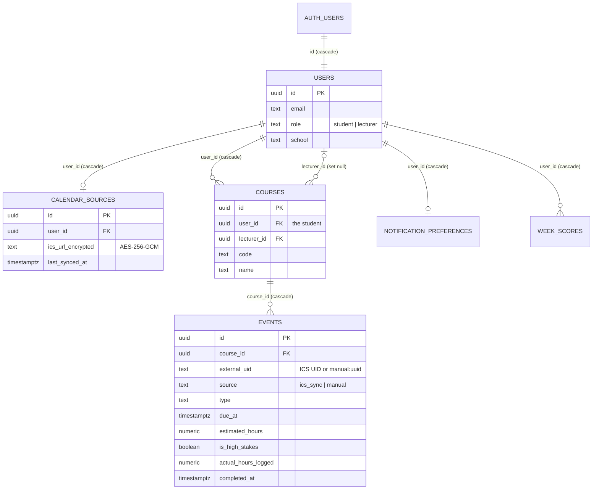

# Data model

**Owner:** Tshiamo Aphane · **Last reviewed:** 31 October 2026

Every table, who can read or write it, and the database functions that do the privileged work. The source of truth is `supabase/migrations/`; when this page and a migration disagree, the migration wins, and this page needs fixing in the same pull request.

## Tables and relationships



Not shown: `lecturer_allowlist` and `sync_runs` have no foreign keys.

**Courses are per student.** Each student has their own `courses` row for every course in their feed, so two students in the same class have two rows with the same `code`. Lecturer functions group rows by `code` (and `users.school`) to see a cohort.

**Deleting an account cascades.** `deleteMyAccount` deletes the `auth.users` row, which removes the `users` row and, through the cascades above, every calendar source, course, event, preference and score belonging to that student.

## Table by table

| Table                      | Holds                                                                                                       | Students can                      | Written by                                       |
| -------------------------- | ----------------------------------------------------------------------------------------------------------- | --------------------------------- | ------------------------------------------------ |
| `users`                    | One row per account: email, role, school                                                                    | Read their own row                | `complete_signup` (once, at first sign-in)       |
| `calendar_sources`         | The student's encrypted Brightspace feed URL and last sync time                                             | Read their own row                | Server functions, via the service role           |
| `courses`                  | One row per student per course in their feed                                                                | Read their own                    | The sync (service role)                          |
| `events`                   | Due dates: synced from the feed, or added by a lecturer (`source='manual'`)                                 | Read events in their own courses  | The sync; `log_actual_hours`; lecturer functions |
| `notification_preferences` | Three on/off toggles per student (nothing sends yet, CRU-18)                                                | Read, create and update their own | The student                                      |
| `lecturer_allowlist`       | Lower-case emails that get the lecturer role at sign-up                                                     | Nothing (no grants)               | Maintainers, by hand in SQL                      |
| `sync_runs`                | One row per nightly run: totals, failures, duration (90 days)                                               | Nothing (no grants)               | The nightly run (service role)                   |
| `week_scores`              | Legacy cached scores. Not written by the current app; scores are computed on read. Included in data export. | Read their own                    | Nothing currently                                |

Every table has Row Level Security enabled, and every policy compares `auth.uid()` with the row's owner. Some notes:

- `calendar_sources` still has insert and update policies from the baseline, but the `INSERT` and `UPDATE` privileges were revoked from `authenticated` (migration `20261030093000`), so students can't write the table directly. Saves go through `saveCalendarSource`, which validates the URL first.
- `events` has no write policy at all. Students change an event only through `log_actual_hours`.
- `lecturer_allowlist` and `sync_runs` have RLS enabled, no policies and no grants for `anon` or `authenticated`: only the service role can touch them.

## Database functions

All are `SECURITY DEFINER` with a fixed `search_path`, revoked from `PUBLIC` and `anon`, and check the caller inside the function body.

| Function                                    | Callable by           | Does                                                                                                     |
| ------------------------------------------- | --------------------- | -------------------------------------------------------------------------------------------------------- |
| `complete_signup(_role, _school)`           | `authenticated`       | Creates the `users` row once. Ignores `_role`: lecturer only if the email is on the allow-list           |
| `log_actual_hours(_event_id, _hours)`       | `authenticated`       | Sets hours (0 to 200) on an event in one of the caller's own courses                                     |
| `lecturer_courses()`                        | `authenticated`       | The caller's courses (by `lecturer_id`), grouped by code, with student counts                            |
| `lecturer_cohort_weeks(_code, _min_cohort)` | `authenticated`       | Average weekly hours across a course's students; empty below the minimum cohort                          |
| `lecturer_due_dates(_code)`                 | `authenticated`       | Every due date (synced and manual) for one of the caller's courses, de-duplicated across students        |
| `lecturer_upsert_due_date(…)`               | `authenticated`       | Adds or edits a manual due date for the whole course; fills in `lecturer_id` for students who join later |
| `lecturer_delete_due_date(_event_id)`       | `authenticated`       | Deletes a manual due date from one of the caller's courses                                               |
| `hook_require_university_email(event)`      | `supabase_auth_admin` | Supabase Auth "Before User Created" hook: refuses any address not `@myemeris.edu.za`                     |
| `rls_auto_enable()`                         | Event trigger         | Turns RLS on for any new table automatically                                                             |

### How a lecturer gets linked to a course

Lecturer functions only see courses where `courses.lecturer_id` is the lecturer's own id, and nothing in the app sets that link. During the pilot a maintainer does it with `scripts/lecturer.ts` ([ADR-0011](../adr/0011-lecturer-onboarding.md)):

```sh
bun --env-file=.env scripts/lecturer.ts courses                      # codes and student counts
bun --env-file=.env scripts/lecturer.ts add name@myemeris.edu.za \
  --courses PROG6221 --note "IT nominated, expires 2027-01-31"       # dry run: prints the plan
bun --env-file=.env scripts/lecturer.ts add … --yes                  # apply
bun --env-file=.env scripts/lecturer.ts list                         # who has access to what
bun --env-file=.env scripts/lecturer.ts remove name@myemeris.edu.za --yes
```

- `add` allow-lists the email. If they haven't signed up, `complete_signup` makes them a lecturer at first sign-in; run `add` again afterwards to link their courses. If they already signed up as a student, it promotes them.
- Linking sets `lecturer_id` on every student's row for that exact course code. Rows already linked to a different lecturer are never overwritten; the script warns instead.
- Students who join a course later aren't linked automatically. Run `add` again, or they're picked up the next time the lecturer adds or edits a due date (`lecturer_upsert_due_date` fills in rows with the same code and school).
- `remove` unlinks their courses, demotes them to student and deletes them from the allow-list. Manual due dates they added stay on students' calendars.
- It needs the service-role key, so it runs from a maintainer's machine only. Record every run on the CRU-17 issue.

## Changing the schema

- One migration per change in `supabase/migrations/`, named `YYYYMMDDHHMMSS_cru_<n>_<slug>.sql`. History starts at `00000000000000_baseline.sql`; the original August files are in `supabase/migrations-archive/`.
- Additive only, with the RLS policies and `GRANT`/`REVOKE` in the same file ([AGENTS.md](../../AGENTS.md)).
- After any change to policies, grants or functions, run `scripts/adversarial-test-matrix.ts` (see [CONTRIBUTING.md](../../CONTRIBUTING.md#tests)).
- Test it on a local database (`bun run db:start`, then `bun run db:reset` after each change), regenerate the types with `bun run db:types`, and update this page, all in the same pull request. The `schema` CI job fails if the migrations don't build a database or the types don't match.
