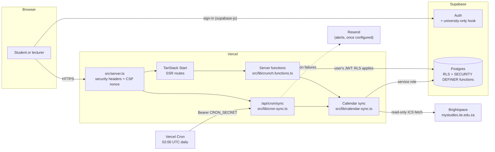
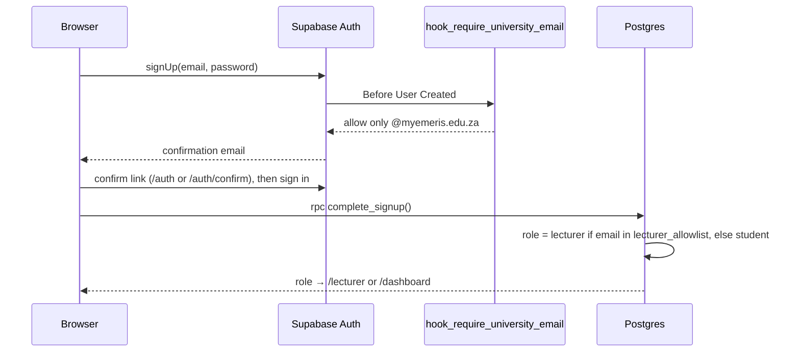

# Architecture overview

**Owner:** Mmoloki Kgololosego · **Last reviewed:** 31 October 2026

How Crunch fits together: one web application and one database, with a single outbound connection to Brightspace. Read this first, then [data-model.md](data-model.md) for the tables and [the ADRs](../adr/README.md) for why it's built this way.

## The system on one page

- **One app.** The pages, the server functions and the sync engine are all one TanStack Start app on Vercel. There is no separate backend service ([ADR-0003](../adr/0003-one-app-one-database.md)).
- **One database.** Supabase provides Postgres, authentication and Row Level Security. Every rule about who can see what is enforced in Postgres itself ([ADR-0004](../adr/0004-authorization-in-postgres.md)).
- **One outbound call.** The only thing the server fetches from the internet is a student's Brightspace calendar feed, from an allow-listed host ([ADR-0007](../adr/0007-calendar-feed-urls.md)).

## Code map

| Path                                              | What lives there                                                                                          |
| ------------------------------------------------- | --------------------------------------------------------------------------------------------------------- |
| `src/server.ts`                                   | The fetch handler every request passes through: CSP nonce, security headers, `/api/cron/sync`, error page |
| `src/router.tsx`, `src/start.ts`                  | Router setup; stamps the CSP nonce on TanStack's inline scripts                                           |
| `src/routes/`                                     | Pages. See [src/routes/README.md](../../src/routes/README.md)                                             |
| `src/lib/crunch.functions.ts`                     | Every server function the browser can call, each behind `requireSupabaseAuth` and Zod validation          |
| `src/lib/calendar-sync.ts`                        | `runCalendarSync`: fetch, parse, classify and upsert one student's feed                                   |
| `src/lib/cron-sync.ts`                            | The nightly run over every calendar source, and its `sync_runs` log                                       |
| `src/lib/ics-*.ts`                                | Feed parsing, URL allow-list, AES-256-GCM encryption of saved feed URLs                                   |
| `src/lib/sync-*.ts`                               | Pure helpers: what to delete (`sync-plan`), cooldown, run summaries, alert emails                         |
| `src/lib/workload.ts`                             | Pure scoring: weekly totals, Light → Brutal levels, clash detection                                       |
| `src/lib/security-headers.ts`, `server-errors.ts` | Response headers and CSP; what a database error may tell the browser                                      |
| `src/integrations/supabase/`                      | Browser client, server client, service-role client, auth middleware, generated types                      |
| `supabase/migrations/`                            | The schema, policies, grants and database functions (see [data-model.md](data-model.md))                  |
| `scripts/`                                        | Operational scripts: adversarial test, backups, key rotation, a manual sync test                          |

Modules without I/O (`workload`, `ics-parser`, `ics-url`, `sync-plan`, `sync-run`, `cron-auth`, …) have `*.test.ts` files beside them. Keep new logic in modules like these so it can be unit tested.

## How a request is handled

1. **Every request** enters `src/server.ts`. It creates a fresh nonce, passes it to the router in a request header, and adds the security headers (strict CSP, `frame-ancestors 'none'`, `nosniff`, referrer and permissions policies) to the response ([ADR-0009](../adr/0009-nonce-csp.md)).
2. **Pages** are server-rendered by TanStack Start. Pages under `_authenticated/` check for a Supabase session in `beforeLoad` and redirect to `/auth` without one. That check is for the user's convenience only; it isn't the security boundary.
3. **Data** is always fetched through a server function in `crunch.functions.ts`. The `requireSupabaseAuth` middleware verifies the caller's Supabase access token on the server, then queries Postgres as that user, so Row Level Security applies to every read.
4. **Privileged writes** (logging hours, lecturer due dates, cohort aggregates, sign-up) call `SECURITY DEFINER` database functions that check ownership inside the function body.
5. **Errors** from the database are logged on the server and replaced with a generic message, except messages our own functions raise for users (SQLSTATE `P0001`). See `server-errors.ts`.

## Authentication and roles

- Passwords and sessions belong to Supabase Auth. Crunch never stores a password.
- The browser never chooses a role. `complete_signup` decides it from `lecturer_allowlist`, which only the service role can change ([ADR-0005](../adr/0005-lecturer-allowlist.md)).
- Non-university addresses are refused by an Auth hook before an account exists ([ADR-0006](../adr/0006-university-only-signup.md)).
- `/auth/confirm` verifies a token only when the student presses the button, so Microsoft 365's link scanner can't use up the link ([ADR-0010](../adr/0010-scanner-safe-email-confirmation.md)). It takes effect once production email is configured (CRU-33).

## The calendar sync

There is one sync code path, `runCalendarSync(calendarSourceId)`, with three callers ([ADR-0001](../adr/0001-sync-pipeline.md), [ADR-0002](../adr/0002-sync-removes-stale-events.md)):

| Trigger    | Where                                   | Notes                                                       |
| ---------- | --------------------------------------- | ----------------------------------------------------------- |
| Onboarding | `saveCalendarSource`                    | Runs before the response, so the screen shows a real result |
| "Sync now" | `syncCalendarNow` (Settings)            | 2-minute cooldown per student (`sync-cooldown.ts`)          |
| Nightly    | `/api/cron/sync`, Vercel Cron 02:00 UTC | Constant-time bearer check; 4 students at a time; logged    |

What one sync does:

1. Decrypt the saved feed URL and check it against the allow-list again.
2. Fetch it: HTTPS only, 15-second timeout, at most 3 redirects (each re-checked), 5 MB cap.
3. Parse the `VEVENT`s, group them into courses, and classify each by title (exam, essay, quiz, problem set, reading, other) with default hours and stakes.
4. Upsert all courses in one call and all events in another. The upsert never touches `actual_hours_logged` or `completed_at`.
5. Remove synced events that have left the feed, unless the student logged hours on them or completed them. Lecturer-added events are never removed, and an empty feed deletes nothing.
6. Return `ok`, `invalid_url`, `unreachable`, `empty` or `cooldown`.

The nightly run records totals, failing sources and duration in `sync_runs` (kept 90 days). Failures log `[cron-sync] ATTENTION`, and email the team once `RESEND_API_KEY` and `SYNC_ALERT_TO` are set. The runbook's "Checking the nightly sync" section has the queries.

## Scoring

`workload.ts` is pure and runs wherever it's called. For each week (Monday to Sunday, UTC) it adds up each event's hours: the student's logged hours if there are any, otherwise the estimate. Then it assigns a level:

| Level    | Weekly hours   |
| -------- | -------------- |
| Light    | under 8        |
| Moderate | 8 to under 16  |
| Heavy    | 16 to under 26 |
| Brutal   | 26 and over    |

Two or more high-stakes items from different courses due on the same day (UTC) are flagged as a clash. Logged hours replace the estimate for that item only; nothing is learned across items or students yet (that's on the roadmap).

## The lecturer view

Lecturers only ever see aggregates, through `SECURITY DEFINER` functions: `lecturer_courses`, `lecturer_cohort_weeks`, `lecturer_due_dates`, `lecturer_upsert_due_date` and `lecturer_delete_due_date`. A cohort heatmap returns nothing until at least `LECTURER_MIN_COHORT` (default 8) distinct students share the course ([ADR-0008](../adr/0008-cohort-minimum.md)).

> **Known gap.** A lecturer sees a course only where `courses.lecturer_id` is their user id, and nothing in the app sets that link yet. It has to be set by hand in SQL for at least one student's row of the course. After that, `lecturer_upsert_due_date` fills it in for other students in the same course and school. Tracked in CRU-50 and needed for the lecturer test (CRU-17).

## Environments and deployment

| Environment | App                                | Database                                    |
| ----------- | ---------------------------------- | ------------------------------------------- |
| Production  | Vercel, from `main` on every merge | Supabase project `Crunch` (all real data)   |
| Preview     | Vercel, one per pull request       | None: previews have no database credentials |
| Local       | `bun run dev`                      | Your own Supabase project                   |

There is no staging database yet (CRU-34, on the meeting agenda). Migrations aren't applied automatically: whoever merges applies them, after a backup, as described in [CONTRIBUTING.md](../../CONTRIBUTING.md). Configuration is in environment variables, listed in the [README](../../README.md#environment-variables).

## Where to go next

- [data-model.md](data-model.md): tables, relationships, access rules, database functions
- [docs/adr/](../adr/README.md): why things are the way they are
- [docs/runbook.md](../runbook.md): when something goes wrong in production
- [AGENTS.md](../../AGENTS.md): conventions every change must follow
